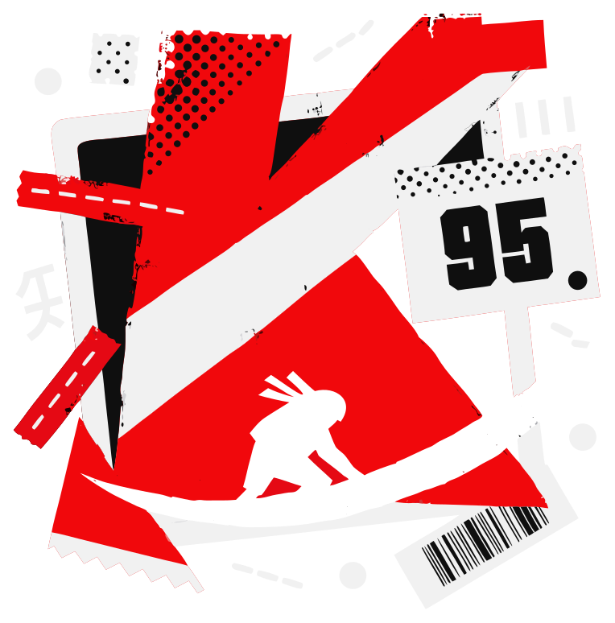
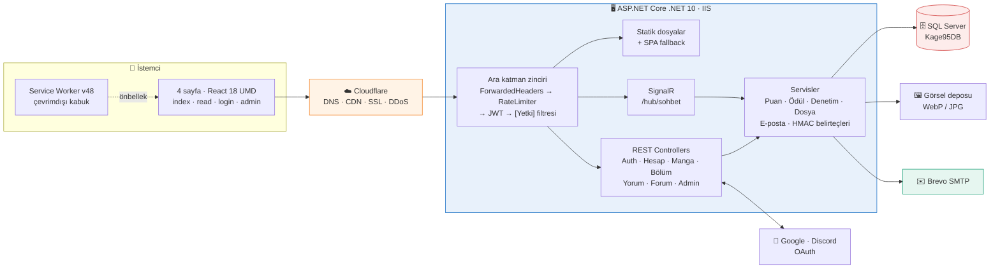
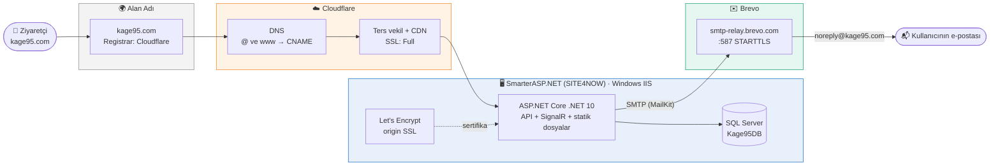
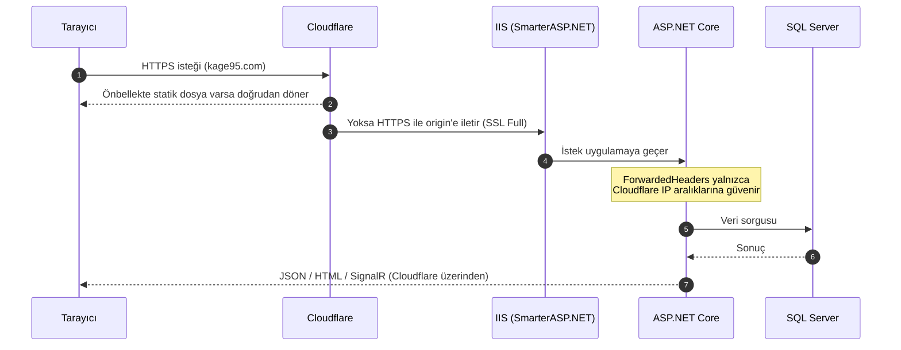
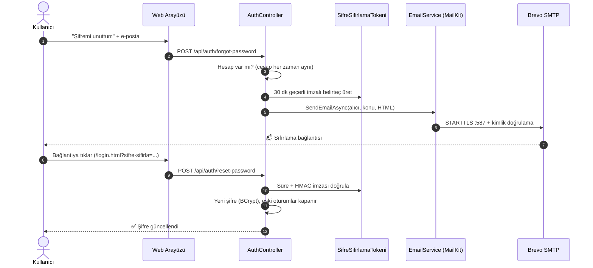
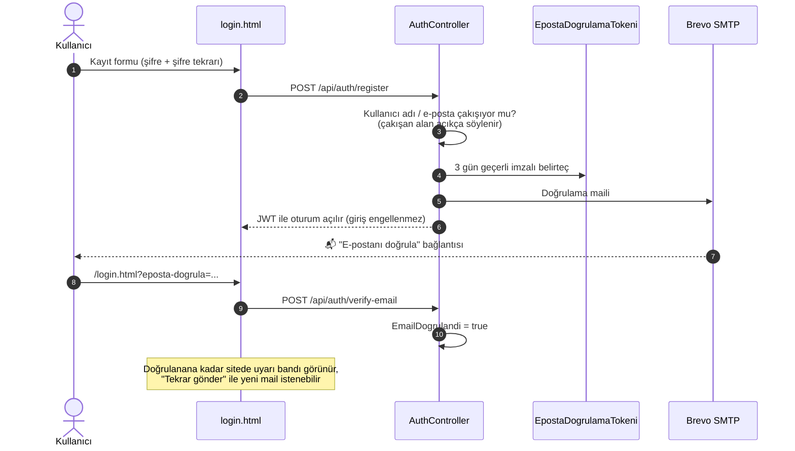
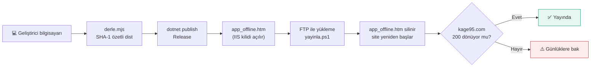
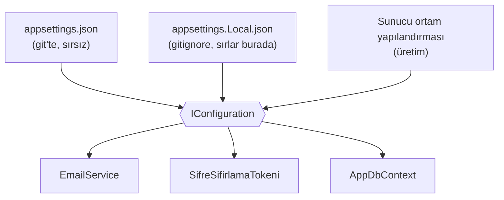

<div align="center">

  <a href="https://kage95.com" target="_blank" rel="noopener noreferrer">
    
  </a>

  <br />

  # 影 KAGE 95
  ### *Minimalist, Hızlı ve Karanlık Türkçe Manga Platformu*

  <p align="center">
    <a href="https://kage95.com"></a>
    <a href="CHANGELOG.md"></a>
    <a href="https://dotnet.microsoft.com/"></a>
    <a href="https://react.dev"></a>
    <a href="https://dotnet.microsoft.com/apps/aspnet/signalr"></a>
    <a href="https://www.microsoft.com/sql-server/"></a>
    <a href="https://web.dev/progressive-web-apps/"></a>
    <a href="LICENSE"></a>
  </p>

  <p align="center">
    <a href="#-temel-özellikler"><b>Özellikler</b></a> &bull;
    <a href="#️-mimari-yapı-system-architecture"><b>Mimari</b></a> &bull;
    <a href="#-sürüm-geçmişi--changelog"><b>Sürüm Geçmişi</b></a> &bull;
    <a href="#-dizin-yapısı"><b>Dizin Yapısı</b></a> &bull;
    <a href="#-kurulum-ve-çalıştırma"><b>Kurulum</b></a> &bull;
    <a href="#-güvenlik--gizlilik"><b>Güvenlik</b></a> &bull;
    <a href="#️-lisans-ve-telif-hakkı-license"><b>Lisans</b></a>
  </p>

  <br />

  > **"Karanlığın gölgesinde okunan hikayeler."**  
  > KAGE 95 (影), karanlık ve kan kırmızısı Japon minimalist estetiğini modern web teknolojileriyle birleştiren; sıfır hantallık, yüksek hız ve zengin topluluk etkileşimi sunan yeni nesil manga arşivi ve kütüphanesidir.

</div>

---

## 🏛️ Mimari Yapı (System Architecture)

KAGE 95 tek parça (modüler monolit) bir uygulamadır: aynı ASP.NET Core (.NET 10) süreci hem statik ön yüzü, hem REST API'yi, hem de SignalR sohbetini sunar. Ayrı mikro-servis, kuyruk veya önbellek sunucusu yoktur; bu sayede tek bir IIS uygulaması ve tek bir SQL Server veritabanıyla çalışır.



| Katman | Sorumluluk | Neden böyle? |
|---|---|---|
| **İstemci** | Sayfa başına tek HTML dosyası; React UMD + Babel, `derle.mjs` ile önceden derlenip küçültülür ve SHA-1 özetli adla `dist/` altına yazılır | Paketleyici (webpack/vite) bağımlılığı yok; özetli dosya adı önbelleği güvenle uzun tutar |
| **Kenar** | Cloudflare statik dosyaları önbellekler, SSL ve DDoS korumasını üstlenir | Paylaşımlı barındırmadaki sunucu yükü düşer |
| **Uygulama** | Ara katman zinciri her isteği sırayla süzer; controller'lar ince kalır, iş kuralları servislerdedir | Hız sınırı ve yetki kontrolü tek yerde, atlanamaz |
| **Belirteçler** | Şifre sıfırlama ve e-posta doğrulama bağlantıları HMAC-SHA256 ile imzalanır, veritabanında tutulmaz | Ek tablo ve temizlik işi gerekmez; şifre/e-posta değişince bağlantı kendiliğinden geçersizleşir |
| **Veri** | EF Core + SQL Server; şema değişiklikleri açılışta idempotent SQL ile uygulanır ve `Veritabani_Kurulumu.sql` ile eşlenir | Paylaşımlı sunucuda migration aracı çalıştırmadan güvenli şema güncellemesi |

---

## 🧩 Servisler & Altyapı (Hangi Hizmeti Nerede Kullanıyoruz?)

Kage 95'in çalışması için kullanılan dış hizmetlerin tamamı aşağıdadır. Bu bölümde **hiçbir parola, API anahtarı veya sunucu sırrı yer almaz**; yalnızca hizmet adları ve ayar anahtarı adları yazılıdır.

<p align="center">
  
  
  
  
  
  
</p>

### 📋 Servis Kartları

| | Hizmet | Ne için kullanılıyor? | Nerede ayarlanıyor? |
|:-:|---|---|---|
| 🌍 | **Alan adı: `kage95.com`** | Sitenin adresi. Alan adı kaydı (registrar) ve DNS yönetimi Cloudflare'dedir. | Cloudflare paneli → Domain Registration |
| ☁️ | **Cloudflare** | DNS, ters vekil (proxy), CDN önbelleği, DDoS koruması, SSL modu **Full** | Cloudflare paneli → `kage95.com` |
| 🖥️ | **SmarterASP.NET (SITE4NOW)** | Windows / IIS barındırma, .NET 10 çalışma ortamı, SQL Server veritabanı, FTP | SmarterASP.NET kontrol paneli |
| 🗄️ | **Microsoft SQL Server** | Kullanıcı, manga, bölüm, yorum, forum verileri (`Kage95DB`) | `ConnectionStrings:DefaultConnection` |
| ✉️ | **Brevo (eski adıyla Sendinblue)** | Şifre sıfırlama, e-posta doğrulama ve sistem e-postaları (SMTP) | `EmailSettings` bölümü |
| 🔐 | **Let's Encrypt** | Kaynak sunucuda (origin) ücretsiz SSL sertifikası | SmarterASP.NET paneli, `.well-known/web.config` |
| 📦 | **FTP + `yayinla.ps1`** | Tek komutla canlıya yayın | `deploy/yayin.Local.json` (git'e girmez) |
| 💬 | **Discord** | Topluluk sunucusu ve iletişim | `discord.gg/yxZZ7m2x8a` |

### 🗺️ Altyapı Haritası



### 🌐 Bir İstek Nasıl İlerler?



### ✉️ Brevo ile Şifre Sıfırlama Akışı



**Güvenlik notları**

- Belirteç **veritabanında saklanmaz**: `kullaniciId.bitişZamanı` verisi, `JwtSettings:Secret` ve şifre hash parmak izi ile HMAC-SHA256 imzalanır.
- Şifre değiştiği anda parmak izi değişir; böylece bağlantı **tek kullanımlıktır**.
- `forgot-password` hesap var olsa da olmasa da aynı cevabı verir (kullanıcı adı/e-posta sızdırmaz).
- Hız sınırı: `sifre-sifirlama` politikası, IP başına 15 dakikada 5 istek.

> ✅ Giriş sayfasındaki "Şifremi unuttum" formu ve e-postadaki `/login.html?sifre-sifirla=` bağlantısını karşılayan yeni şifre ekranı hazırdır.

### 📨 E-posta Doğrulama Akışı



### 🚀 Yayın (Deploy) Akışı



Yayın için gerekli FTP bilgileri `deploy/yayin.Local.json` dosyasında tutulur. Bu dosya `.gitignore` içindedir ve **hiçbir koşulda commit edilmemelidir**.

### 🔑 Yapılandırma Anahtarları (değer yok, yalnızca ad)

| Ayar | Anahtar | Not |
|---|---|---|
| Veritabanı | `ConnectionStrings:DefaultConnection` | Sunucuda ortam yapılandırmasıyla verilir |
| JWT imzası | `JwtSettings:Secret` | Şifre sıfırlama belirteci de bu anahtardan türetilir |
| E-posta sunucusu | `EmailSettings:Server`, `Port` | `smtp-relay.brevo.com`, `587` (STARTTLS) |
| Gönderen | `EmailSettings:SenderName`, `SenderEmail` | `Kage 95`, `noreply@kage95.com` |
| SMTP kimliği | `EmailSettings:Username`, `Password` | **Gizli.** Git'teki `appsettings.json` içinde boş durur; gerçek değer gitignore'daki `appsettings.Local.json` dosyasında (yerel ve sunucu) tutulur |
| Site adresi | `Site:Url` | Sıfırlama bağlantısının kökü (`https://kage95.com`) |



---

## ✨ Temel Özellikler

### 🔐 0. Hesap & Kimlik *(v2.6 Yeni)*

<table>
  <tr>
    <td width="50%" valign="top">
      <b>📨 E-posta doğrulama</b><br/>
      Kayıttan sonra doğrulama maili gider. Giriş engellenmez; doğrulanana kadar sitede uyarı bandı ve <i>"Tekrar gönder"</i> düğmesi görünür.
    </td>
    <td width="50%" valign="top">
      <b>🔁 Şifre tekrarı</b><br/>
      Kayıt ve şifre sıfırlama formlarında ikinci şifre alanı; eşleşmezse istek sunucuya hiç gitmez.
    </td>
  </tr>
  <tr>
    <td valign="top">
      <b>✉️ Mail ile şifre sıfırlama</b><br/>
      <code>noreply@kage95.com</code> adresinden Brevo SMTP ile gönderilen, 30 dakika geçerli, tek kullanımlık bağlantı.
    </td>
    <td valign="top">
      <b>🔑 Google & Discord ile giriş</b><br/>
      OAuth sağlayıcısı yapılandırıldığında düğmeler kendiliğinden görünür; mevcut şifreli hesaplar otomatik birleştirilmez.
    </td>
  </tr>
  <tr>
    <td valign="top">
      <b>🎯 Açık kayıt hataları</b><br/>
      <i>"Kayıt oluşturulamadı"</i> yerine sorunun kullanıcı adında mı e-postada mı olduğu söylenir. Deneme sayısını <code>kayit</code> hız sınırı kısar.
    </td>
    <td valign="top">
      <b>🛡️ Durumsuz belirteçler</b><br/>
      Sıfırlama ve doğrulama bağlantıları HMAC-SHA256 ile imzalanır, veritabanında saklanmaz.
    </td>
  </tr>
</table>

### 📖 1. Akıllı Okuma Deneyimi
- **Çift Okuma Modu:** Geleneksel sayfa çevirmeli **Klasik Mod** (çift sayfa & tek sayfa) ve mobil uyumlu kesintisiz dikey **Webtoon Modu**.
- **Üst Okuma İlerleme Çubuğu:** Bölümün neresinde olduğunuzu anlık olarak hissettiren üst 3px kan kırmızısı dinamik ilerleme çizgisi (`top: 0`).
- **Yüzen Hızlı Bölüm Geçişi (Floating Nav):** Ekrana tek dokunuşla altta beliren cam efektli `[ ← Önceki ] [ Bölüm X ] [ Sonraki → ]` kontrol hapı.
- **Bölüm İçi Anlık Filtreleme & Görünüm:** Manga detay sayfasında 100+ bölümlü seriler için anında numara/ad araması ve **`☵ Izgara`** veya **`☰ Liste`** görünümü değiştirme imkânı.
- **Klavye Kısayolları & Göz Dinlendirme:** Ok tuşları (`←`/`→`), `A`/`D`, `?` yardım penceresi ve gece okuma parlaklık/filtre ayarı.

### 🌐 2. Kusursuz SPA Routing & Doğrudan Link Desteği *(v2.5 Yeni)*
- **Temiz URL'ler:** Tüm sayfalar temiz adreslerle çalışır (`/manga/18`, `/iletisim`, `/kutuphane`, `/forum`, `/sohbet`, `/liderlik`, `/profil`).
- **F5 Yenileme ve Doğrudan Giriş Garantisi:** Sunucu tarafındaki akıllı SPA Fallback (`app.MapFallback`) sayesinde doğrudan link yapıştırıldığında ya da sayfa yenilendiğinde asla 404/çökme yaşanmaz; anında ilgili manga veya sayfa açılır.
- **Kurşun Geçirmez Service Worker (v48):** Gezinme isteklerinde `ERR_INVALID_RESPONSE` hatalarını tamamen engelleyen, çevrimdışı dahi olsa index kabuğunu ayağa kaldıran zırhlı servis çalışanı.

### 🎨 3. Siber-Gotik Manga Vitrini & Akıllı Okuma Şeridi *(v2.5 Yeni)*
- **Taşmayan Cam Kapak Paneli:** Farklı en-boy oranlarındaki kapak görsellerinin kesilmesini, taşmasını veya bulanıklaşmasını önleyen modern cam vitrin (`contain` & `glassmorphic` arka plan).
- **Kaldığın Yerden Devam Et Şeridi:** Kullanıcının okuma durumu yerel depodan anlık taranarak kapak altında otomatik şerit gösterilir:
  - Okunuyorsa: *"Kaldığın Yerden Devam Et (Bölüm X)"*
  - Hiç okunmamışsa: *"İlk Bölümden Başla (Bölüm 1)"*
- **Yumuşak Dokunma Hissi:** Tüm manga kartlarında mobil ve masaüstüne optimize mikromimikler ve akıcı geçişler.

### 💬 4. Birleşik Topluluk Ekosistemi & Modern İletişim
- **Topluluk Çatısı:** Forum ve Sohbet tek bir sezgisel **"Topluluk"** başlığında birleşti. Masaüstünde şık açılır kart (dropdown), mobilde 5 sekmeli ergonomik alt gezinme barı.
- **Gerçek Zamanlı Sohbet (SignalR):** Düşük gecikmeli WebSockets, SVG çıkartma (sticker) paketleri, hız sınırı (rate limit) ve susturma mekanizmaları.
- **Yenilenen İletişim Portalı:** Sadeleştirilmiş siber-gotik cam kart tasarımı, doğrudan resmi Discord sunucu daveti (`discord.gg/yxZZ7m2x8a`) ve e-posta desteği.
- **Gelişmiş Yorum Sistemi:** Bölüm ve seri bazlı yorumlar, yanıt zincirleri (nested replies), beğeni, şikayet bildirme ve `||gizli||` spoiler filtreleme.

### 🔒 5. Çok Katmanlı Siber Güvenlik Zırhı *(v2.3 Hardened)*
- **DDoS & Rate Limiting:** IP başına giriş, kayıt ve genel tarama sınırları (ASP.NET Core RateLimiter).
- **RAM Doyurma & DoS Koruması:** Bölüm başına azami 150 sayfa, arama sorgularında 60 karakter, yorumlarda 1000 karakter sıkı doğrulaması.
- **WebSocket Taşkın Koruması:** Sohbet odasında IP başına 3 saniyede azami 2 mesaj izni ve bellek sızıntısını önleyen döngüsel bellek tamponu (ring buffer).
- **Timing-Attack Korumalı Kimlik Doğrulama:** Sabit zamanlı karşılaştırma mimarisiyle güçlendirilmiş BCrypt şifreleme.
- **Cloudflare Edge Entegrasyonu:** Yalnızca Cloudflare edge proxy IP bloklarına güvenen `ForwardedHeaders` filtresi (sahte başlıklarla hız sınırı atlatılamaz).

### ✨ 6. Akıcı Mikro-Etkileşimler (Smooth Animations) *(v2.4 Yeni)*
- **Hamburger Morphing:** 3 çizgili mobil menü butonunun 'X' ikonuna yumuşak geçiş animasyonu.
- **Kayan Çekmece & Modallar:** `cubic-bezier(0.16, 1, 0.3, 1)` eğrisiyle açılan yumuşak yan menü ve diyaloglar.
- **Profil Menüsü Süzülmesi:** Kullanıcı profil kartının hafif yaylanarak açılış efekti.

### 🏆 7. Oyunlaştırma (Gamification) & Liderlik
- **XP ve Rütbeler:** Bölüm okuma, yorum yapma, puan verme ve günlük girişlerle puan kazanımı (`Çırak` → `Efsane` rütbeleri).
- **Özelleştirilebilir Profil:** Seviye atladıkça açılan ad renkleri, özel yazı tipleri, neon parıltı efektleri ve rozetler.
- **Dinamik Liderlik Tablosu:** Haftalık, aylık ve tüm zamanlar periyotlarında en aktif okuyucular (`#/liderlik`).

### 🛡️ 8. Yönetim Paneli (Admin Dashboard)
- **Granüler İzin Sistemi:** `Owner`, `Admin` ve `User` rolleriyle `manga.yaz`, `bolum.duzenle`, `yorum.sil`, `sohbet.yonet` gibi hassas yetkilendirme.
- **Görsel & Sayfa Yöneticisi:** Sürükle-bırak sayfa sıralama, toplu görsel yükleme, otomatik WebP sıkıştırma ve öne çıkan afiş optimizasyonu.
- **Denetim ve Loglama:** Kimin ne zaman hangi işlemi yaptığını kaydeden denetim (audit) sistemi.

---

## 🚀 Sürüm Geçmişi & Changelog

Projenin tüm geçmiş sürümleri, yenilikleri ve teknik detayları **[CHANGELOG.md](CHANGELOG.md)** dosyasında ayrıntılı olarak kayıt altına alınmaktadır.

| Sürüm | Yayın Tarihi | Önemli Yenilikler | Durum |
| :--- | :---: | :--- | :---: |
| **v2.6.0** | 28 Ekim 2026 | **E-posta doğrulama, şifre tekrarı alanı, Brevo ile mail şifre sıfırlama, Google/Discord girişi, alana özel kayıt hataları, SEO (sitemap, OG, JSON-LD)** | 🟢 **Son Sürüm (Mevcut)** |
| **v2.5.0** | 26 Ekim 2026 | Kusursuz SPA Routing (`/manga/:id`, F5 fallback), Service Worker v48 (sıfır çökme), Taşmayan Cam Manga Vitrini, Akıllı Okuma Şeridi, Modern İletişim Portalı | ⚪ Tamamlandı |
| **v2.4.0** | 26 Ekim 2026 | Akıcı mikro-etkileşimler, 3 çizgi hamburger morphing animasyonu, kayan çekmece ve modal süzülmeleri | ⚪ Tamamlandı |
| **v2.3.0** | 26 Ekim 2026 | Kapsamlı siber güvenlik zırhı (Rate limiting, RAM doyurma engeli, SignalR taşkın koruması, Timing attack proof şifreleme) | ⚪ Tamamlandı |
| **v2.2.0** | 25 Ekim 2026 | Birleşik Topluluk Ekosistemi (Forum + Sohbet), Masaüstü Topluluk dropdown'ı, 100+ bölümlü seriler için anlık arama ve Izgara/Liste modu | ⚪ Tamamlandı |
| **v2.1.0** | 25 Ekim 2026 | Hero carousel otomatik kayan afişler, WebP görsel optimizasyonu, mobil klavye ve dokunmatik iyileştirmeleri | ⚪ Tamamlandı |
| **v2.0.0** | 24 Ekim 2026 | Büyük Canlı Yayın Lansmanı ([kage95.com](https://kage95.com)), PWA desteği, SignalR canlı sohbet, XP & rütbe sistemi, SQL Server `Kage95DB` | ⚪ Tamamlandı |
| **v1.0.0** | 20 Ekim 2026 | İlk çekirdek sürüm (Çift modlu okuyucu motoru, ASP.NET Core REST API, Koyu minimalist estetik) | ⚪ Tamamlandı |

---

## 📂 Dizin Yapısı

```text
kage95/
├── backend/                      # ASP.NET Core Web API (.NET 10)
│   ├── Controllers/              # REST API Uçları (Mangas, Chapters, Forum, Sohbet, Auth vb.)
│   ├── Data/                     # AppDbContext & EF Core SQL Bağlantısı
│   ├── Hubs/                     # SignalR SohbetHub (/hub/sohbet)
│   ├── Models/                   # Veritabanı Varlıkları (Entities) ve DTO Şemaları
│   ├── Security/                 # JWT Yetkilendirme & Granüler [Yetki] Filtreleri
│   ├── Services/                 # Puan, Ödül, Yorum, Dosya Upload ve Denetim Servisleri
│   └── Veritabani_Kurulumu.sql   # SQL Server Şeması ve İlk Kurulum Tabloları
├── css/                          # Stil Şablonları
│   ├── vurgu.css                 # Hero, Okuyucu, Kartlar, Animasyonlar ve Responsive Stiller
│   └── forum.css                 # Forum ve Topluluk Bileşen Stilleri
├── js/                           # Modüler Ön Yüz Betikleri
│   ├── yol.js                    # Temiz SPA URL Yönlendiricisi & pushState Motoru
│   ├── config.js                 # API, Discord ve Sosyal Bağlantı Konfigürasyonu
│   ├── tema.js                   # 4 Hazır Tema (Kage, Kağıt, Mono, Gece) Motoru
│   ├── sohbet.js                 # SignalR Gerçek Zamanlı Sohbet İstemcisi
│   ├── forum.js                  # Forum İstemcisi ve Tartışma Arayüzü
│   ├── yorum.js                  # Zengin Metin & Spoiler Destekli Yorum Sistemi
│   ├── liderlik.js               # Dinamik Liderlik Tablosu Mantığı
│   ├── puan.js                   # 5 Yıldızlı Puanlama Bileşeni
│   └── pwa.js                    # Service Worker Kayıt ve Otomatik Tazeleyici
├── deploy/                       # Dağıtım ve Optimizasyon Araçları
│   └── araclar/derle.mjs         # Babel + esbuild Minification ve SHA-1 Cache-Buster
├── index.html                    # Ana Sayfa, Seri Detay, Kütüphane, Liderlik ve Topluluk
├── read.html                     # Gelişmiş Manga Okuyucu Motoru
├── admin.html                    # Yönetim Portalı
├── login.html                    # Giriş ve Kayıt Ekranı
├── logo.svg                      # Özgün KAGE 95 Vektörel Mühür & Marka Logosu
├── sw.js                         # PWA Servis Çalışanı (Service Worker v48 Zırhlı)
├── CHANGELOG.md                  # Sürüm Geçmişi ve Değişiklik Günlüğü
└── LICENSE                       # Telif Hakkı ve Mülkiyet Lisansı
```

---

## 🚀 Kurulum ve Çalıştırma

### Otomatik doğrulama

Her `main` push'unda ve pull request'te `.github/workflows/ci.yml` şu iki kontrolü
çalıştırır:

- .NET 10 backend restore ve Release build
- Frontend Babel/esbuild derleme ve küçültme

Yerelde frontend derlemesini tekrarlamak için:

```powershell
npm ci --prefix deploy/araclar
node deploy/araclar/derle.mjs
```

Backend build'i için .NET SDK 10 gerekir:

```powershell
dotnet restore backend/backend.csproj
dotnet build backend/backend.csproj --configuration Release --no-restore
```

### Gereksinimler
* [.NET 10 SDK](https://dotnet.microsoft.com/)
* [SQL Server](https://www.microsoft.com/sql-server/) veya [SQL Server Express](https://www.microsoft.com/sql-server/sql-server-downloads) (`.\SQLEXPRESS`)
* [Node.js](https://nodejs.org/) (Sadece ön yüzü derlemek için - opsiyonel)

### 1. Veritabanını Hazırlama
SQL Server Management Studio (SSMS) veya `sqlcmd` ile veritabanını oluşturun:
```powershell
sqlcmd -S .\SQLEXPRESS -E -i backend/Veritabani_Kurulumu.sql
```

### 2. Backend API Yapılandırması
`backend/appsettings.Local.json` dosyası oluşturun:
```json
{
  "ConnectionStrings": {
    "DefaultConnection": "Server=.\\SQLEXPRESS;Database=Kage95DB;Trusted_Connection=True;TrustServerCertificate=True;"
  },
  "JwtSettings": {
    "Secret": "en-az-32-karakter-uzunlugunda-guclu-bir-jwt-gizli-anahtari"
  }
}
```

`backend/appsettings.Local.json` Git tarafından yok sayılır. JWT secret'ı
en az 32 karakterlik rastgele bir değer yapın; production ortamında secret'ı
dosyaya yazmak yerine `JwtSettings__Secret` ortam değişkeni veya sunucu secret
store kullanın. `deploy/appsettings.Production.json` bilerek boş secret ile
gelir; uygulama eksik secret ile başlarsa açıkça hata verir.

### Google ve Discord ile giriş

Sosyal giriş düğmeleri yalnızca sağlayıcı bilgileri yapılandırılmışsa giriş
sayfasında görünür. Google Cloud Console'da şu callback adresini ekleyin:
`https://kage95.com/api/auth/external/google/callback`. Discord Developer
Portal'da da `https://kage95.com/api/auth/external/discord/callback` adresini
ekleyin. Client ID ve secret değerlerini production sunucusunda sırasıyla
`Authentication__Google__ClientId`, `Authentication__Google__ClientSecret`,
`Authentication__Discord__ClientId` ve `Authentication__Discord__ClientSecret`
ortam değişkenleriyle verin.

İlk sosyal girişte doğrulanmış e-posta ile yeni bir Kage 95 hesabı oluşturulur.
Mevcut şifreli hesaplar otomatik olarak birleştirilmez; bu, yanlış/ele
geçirilmiş bir OAuth hesabıyla mevcut hesabın devralınmasını önler. Kullanıcı
aynı e-posta ile kayıtlı hesaba önce normal giriş yapmalıdır.

### 3. Backend'i Başlatma
```powershell
cd backend
dotnet run
```
> API varsayılan olarak `http://localhost:5035` üzerinde çalışır. Swagger dokümantasyonuna `http://localhost:5035/swagger` adresinden ulaşabilirsiniz.

### 4. Ön Yüzü Başlatma
Proje kök dizininde herhangi bir yerel HTTP sunucusu açın:
```powershell
python -m http.server 5500
```
Tarayıcınızda `http://localhost:5500` adresini açarak uygulamayı kullanabilirsiniz.

---

## 🔒 Güvenlik & Gizlilik

- **Parola Koruması:** Parolalar endüstri standardı `BCrypt` algoritmasıyla tuzlanarak ve zamanlama saldırılarına (timing attacks) karşı sabit zamanlı doğrulama ile saklanır.
- **Yetkilendirme:** API uçları `Bearer JWT` token ve rol tabanlı talep (claim) kontrolü ile korunur.
- **Hız Sınırı (Rate Limiting):** Brute-force, bot ve DDoS saldırılarına karşı IP ve kullanıcı bazlı istek kısıtlaması uygulanır.
- **XSS & SQL Injection:** Entity Framework Core parametreli sorguları ve HTML sanitization mekanizmaları ile girişler doğrulanır.
- **Ters Proxy Güvenliği:** Cloudflare edge sunucuları doğrulanarak sahte IP ve header enjeksiyonu engellenir.

---

## ⚖️ Lisans ve Telif Hakkı (License)

Telif Hakkı © 2026 **KAGE95** (https://kage95.com) - **Tüm Hakları Saklıdır.** *(All Rights Reserved)*

Bu projenin kaynak kodları, arayüz tasarımları, grafik varlıkları ve veritabanı mimarisi tescilli mülkiyettir. Eser sahibinin açık yazılı izni olmadan projenin kopyalanması, klonlanması, başka bir sunucuda barındırılması, çoğaltılması veya ticari/gayriticari amaçla kullanılması **kesinlikle yasaktır**.

Ayrıntılı yasal şartlar için lütfen **[LICENSE](LICENSE)** dosyasını inceleyin.
