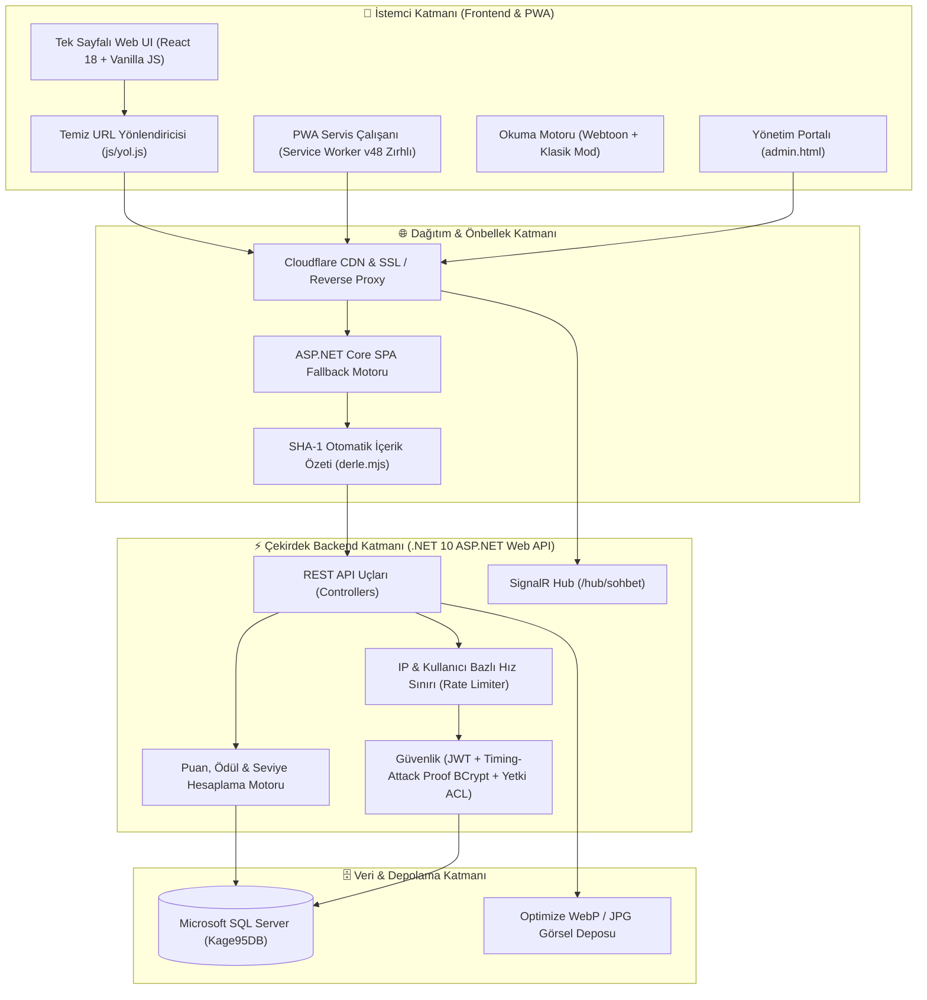

<div align="center">

  <a href="https://kage95.com" target="_blank" rel="noopener noreferrer">
    
  </a>

  <br />

  # 影 KAGE 95
  ### *Minimalist, Hızlı ve Karanlık Türkçe Manga Platformu*

  <p align="center">
    <a href="https://kage95.com"></a>
    <a href="CHANGELOG.md"></a>
    <a href="https://dotnet.microsoft.com/"></a>
    <a href="https://react.dev"></a>
    <a href="https://dotnet.microsoft.com/apps/aspnet/signalr"></a>
    <a href="https://www.microsoft.com/sql-server/"></a>
    <a href="https://web.dev/progressive-web-apps/"></a>
    <a href="LICENSE"></a>
  </p>

  <p align="center">
    <a href="#-temel-özellikler"><b>Özellikler</b></a> &bull;
    <a href="#️-mimari-yapı-system-architecture"><b>Mimari</b></a> &bull;
    <a href="#-sürüm-geçmişi--changelog"><b>Sürüm Geçmişi</b></a> &bull;
    <a href="#-dizin-yapısı"><b>Dizin Yapısı</b></a> &bull;
    <a href="#-kurulum-ve-çalıştırma"><b>Kurulum</b></a> &bull;
    <a href="#-güvenlik--gizlilik"><b>Güvenlik</b></a> &bull;
    <a href="#️-lisans-ve-telif-hakkı-license"><b>Lisans</b></a>
  </p>

  <br />

  > **"Karanlığın gölgesinde okunan hikayeler."**  
  > KAGE 95 (影), karanlık ve kan kırmızısı Japon minimalist estetiğini modern web teknolojileriyle birleştiren; sıfır hantallık, yüksek hız ve zengin topluluk etkileşimi sunan yeni nesil manga arşivi ve kütüphanesidir.

</div>

---

## 🏛️ Mimari Yapı (System Architecture)

KAGE 95, yüksek verimli mikro-servis esintili monolit bir ASP.NET Core (.NET 10) REST API ve gerçek zamanlı SignalR WebSocket omurgası üzerine inşa edilmiştir. Ön yüz katmanı, ağır istemci bağımlılıklarından arındırılmış saf React 18, SPA Fallback mekanizması ve kurşun geçirmez bir Service Worker mimarisi ile çalışır.



---

## ✨ Temel Özellikler

### 📖 1. Akıllı Okuma Deneyimi
- **Çift Okuma Modu:** Geleneksel sayfa çevirmeli **Klasik Mod** (çift sayfa & tek sayfa) ve mobil uyumlu kesintisiz dikey **Webtoon Modu**.
- **Üst Okuma İlerleme Çubuğu:** Bölümün neresinde olduğunuzu anlık olarak hissettiren üst 3px kan kırmızısı dinamik ilerleme çizgisi (`top: 0`).
- **Yüzen Hızlı Bölüm Geçişi (Floating Nav):** Ekrana tek dokunuşla altta beliren cam efektli `[ ← Önceki ] [ Bölüm X ] [ Sonraki → ]` kontrol hapı.
- **Bölüm İçi Anlık Filtreleme & Görünüm:** Manga detay sayfasında 100+ bölümlü seriler için anında numara/ad araması ve **`☵ Izgara`** veya **`☰ Liste`** görünümü değiştirme imkânı.
- **Klavye Kısayolları & Göz Dinlendirme:** Ok tuşları (`←`/`→`), `A`/`D`, `?` yardım penceresi ve gece okuma parlaklık/filtre ayarı.

### 🌐 2. Kusursuz SPA Routing & Doğrudan Link Desteği *(v2.5 Yeni)*
- **Temiz URL'ler:** Tüm sayfalar temiz adreslerle çalışır (`/manga/18`, `/iletisim`, `/kutuphane`, `/forum`, `/sohbet`, `/liderlik`, `/profil`).
- **F5 Yenileme ve Doğrudan Giriş Garantisi:** Sunucu tarafındaki akıllı SPA Fallback (`app.MapFallback`) sayesinde doğrudan link yapıştırıldığında ya da sayfa yenilendiğinde asla 404/çökme yaşanmaz; anında ilgili manga veya sayfa açılır.
- **Kurşun Geçirmez Service Worker (v48):** Gezinme isteklerinde `ERR_INVALID_RESPONSE` hatalarını tamamen engelleyen, çevrimdışı dahi olsa index kabuğunu ayağa kaldıran zırhlı servis çalışanı.

### 🎨 3. Siber-Gotik Manga Vitrini & Akıllı Okuma Şeridi *(v2.5 Yeni)*
- **Taşmayan Cam Kapak Paneli:** Farklı en-boy oranlarındaki kapak görsellerinin kesilmesini, taşmasını veya bulanıklaşmasını önleyen modern cam vitrin (`contain` & `glassmorphic` arka plan).
- **Kaldığın Yerden Devam Et Şeridi:** Kullanıcının okuma durumu yerel depodan anlık taranarak kapak altında otomatik şerit gösterilir:
  - Okunuyorsa: *"Kaldığın Yerden Devam Et (Bölüm X)"*
  - Hiç okunmamışsa: *"İlk Bölümden Başla (Bölüm 1)"*
- **Yumuşak Dokunma Hissi:** Tüm manga kartlarında mobil ve masaüstüne optimize mikromimikler ve akıcı geçişler.

### 💬 4. Birleşik Topluluk Ekosistemi & Modern İletişim
- **Topluluk Çatısı:** Forum ve Sohbet tek bir sezgisel **"Topluluk"** başlığında birleşti. Masaüstünde şık açılır kart (dropdown), mobilde 5 sekmeli ergonomik alt gezinme barı.
- **Gerçek Zamanlı Sohbet (SignalR):** Düşük gecikmeli WebSockets, SVG çıkartma (sticker) paketleri, hız sınırı (rate limit) ve susturma mekanizmaları.
- **Yenilenen İletişim Portalı:** Sadeleştirilmiş siber-gotik cam kart tasarımı, doğrudan resmi Discord sunucu daveti (`discord.gg/yxZZ7m2x8a`) ve e-posta desteği.
- **Gelişmiş Yorum Sistemi:** Bölüm ve seri bazlı yorumlar, yanıt zincirleri (nested replies), beğeni, şikayet bildirme ve `||gizli||` spoiler filtreleme.

### 🔒 5. Çok Katmanlı Siber Güvenlik Zırhı *(v2.3 Hardened)*
- **DDoS & Rate Limiting:** IP başına giriş, kayıt ve genel tarama sınırları (ASP.NET Core RateLimiter).
- **RAM Doyurma & DoS Koruması:** Bölüm başına azami 150 sayfa, arama sorgularında 60 karakter, yorumlarda 1000 karakter sıkı doğrulaması.
- **WebSocket Taşkın Koruması:** Sohbet odasında IP başına 3 saniyede azami 2 mesaj izni ve bellek sızıntısını önleyen döngüsel bellek tamponu (ring buffer).
- **Timing-Attack Korumalı Kimlik Doğrulama:** Sabit zamanlı karşılaştırma mimarisiyle güçlendirilmiş BCrypt şifreleme.
- **Cloudflare Edge Entegrasyonu:** Yalnızca Cloudflare edge proxy IP bloklarına güvenen `ForwardedHeaders` filtresi (sahte başlıklarla hız sınırı atlatılamaz).

### ✨ 6. Akıcı Mikro-Etkileşimler (Smooth Animations) *(v2.4 Yeni)*
- **Hamburger Morphing:** 3 çizgili mobil menü butonunun 'X' ikonuna yumuşak geçiş animasyonu.
- **Kayan Çekmece & Modallar:** `cubic-bezier(0.16, 1, 0.3, 1)` eğrisiyle açılan yumuşak yan menü ve diyaloglar.
- **Profil Menüsü Süzülmesi:** Kullanıcı profil kartının hafif yaylanarak açılış efekti.

### 🏆 7. Oyunlaştırma (Gamification) & Liderlik
- **XP ve Rütbeler:** Bölüm okuma, yorum yapma, puan verme ve günlük girişlerle puan kazanımı (`Çırak` → `Efsane` rütbeleri).
- **Özelleştirilebilir Profil:** Seviye atladıkça açılan ad renkleri, özel yazı tipleri, neon parıltı efektleri ve rozetler.
- **Dinamik Liderlik Tablosu:** Haftalık, aylık ve tüm zamanlar periyotlarında en aktif okuyucular (`#/liderlik`).

### 🛡️ 8. Yönetim Paneli (Admin Dashboard)
- **Granüler İzin Sistemi:** `Owner`, `Admin` ve `User` rolleriyle `manga.yaz`, `bolum.duzenle`, `yorum.sil`, `sohbet.yonet` gibi hassas yetkilendirme.
- **Görsel & Sayfa Yöneticisi:** Sürükle-bırak sayfa sıralama, toplu görsel yükleme, otomatik WebP sıkıştırma ve öne çıkan afiş optimizasyonu.
- **Denetim ve Loglama:** Kimin ne zaman hangi işlemi yaptığını kaydeden denetim (audit) sistemi.

---

## 🚀 Sürüm Geçmişi & Changelog

Projenin tüm geçmiş sürümleri, yenilikleri ve teknik detayları **[CHANGELOG.md](CHANGELOG.md)** dosyasında ayrıntılı olarak kayıt altına alınmaktadır.

| Sürüm | Yayın Tarihi | Önemli Yenilikler | Durum |
| :--- | :---: | :--- | :---: |
| **v2.5.0** | 26 Ekim 2026 | **Kusursuz SPA Routing (`/manga/:id`, F5 fallback), Service Worker v48 (sıfır çökme), Taşmayan Cam Manga Vitrini, Akıllı Okuma Şeridi, Modern İletişim Portalı** | 🟢 **Son Sürüm (Mevcut)** |
| **v2.4.0** | 26 Ekim 2026 | Akıcı mikro-etkileşimler, 3 çizgi hamburger morphing animasyonu, kayan çekmece ve modal süzülmeleri | ⚪ Tamamlandı |
| **v2.3.0** | 26 Ekim 2026 | Kapsamlı siber güvenlik zırhı (Rate limiting, RAM doyurma engeli, SignalR taşkın koruması, Timing attack proof şifreleme) | ⚪ Tamamlandı |
| **v2.2.0** | 25 Ekim 2026 | Birleşik Topluluk Ekosistemi (Forum + Sohbet), Masaüstü Topluluk dropdown'ı, 100+ bölümlü seriler için anlık arama ve Izgara/Liste modu | ⚪ Tamamlandı |
| **v2.1.0** | 25 Ekim 2026 | Hero carousel otomatik kayan afişler, WebP görsel optimizasyonu, mobil klavye ve dokunmatik iyileştirmeleri | ⚪ Tamamlandı |
| **v2.0.0** | 24 Ekim 2026 | Büyük Canlı Yayın Lansmanı ([kage95.com](https://kage95.com)), PWA desteği, SignalR canlı sohbet, XP & rütbe sistemi, SQL Server `Kage95DB` | ⚪ Tamamlandı |
| **v1.0.0** | 20 Ekim 2026 | İlk çekirdek sürüm (Çift modlu okuyucu motoru, ASP.NET Core REST API, Koyu minimalist estetik) | ⚪ Tamamlandı |

---

## 📂 Dizin Yapısı

```text
kage95/
├── backend/                      # ASP.NET Core Web API (.NET 10)
│   ├── Controllers/              # REST API Uçları (Mangas, Chapters, Forum, Sohbet, Auth vb.)
│   ├── Data/                     # AppDbContext & EF Core SQL Bağlantısı
│   ├── Hubs/                     # SignalR SohbetHub (/hub/sohbet)
│   ├── Models/                   # Veritabanı Varlıkları (Entities) ve DTO Şemaları
│   ├── Security/                 # JWT Yetkilendirme & Granüler [Yetki] Filtreleri
│   ├── Services/                 # Puan, Ödül, Yorum, Dosya Upload ve Denetim Servisleri
│   └── Veritabani_Kurulumu.sql   # SQL Server Şeması ve İlk Kurulum Tabloları
├── css/                          # Stil Şablonları
│   ├── vurgu.css                 # Hero, Okuyucu, Kartlar, Animasyonlar ve Responsive Stiller
│   └── forum.css                 # Forum ve Topluluk Bileşen Stilleri
├── js/                           # Modüler Ön Yüz Betikleri
│   ├── yol.js                    # Temiz SPA URL Yönlendiricisi & pushState Motoru
│   ├── config.js                 # API, Discord ve Sosyal Bağlantı Konfigürasyonu
│   ├── tema.js                   # 4 Hazır Tema (Kage, Kağıt, Mono, Gece) Motoru
│   ├── sohbet.js                 # SignalR Gerçek Zamanlı Sohbet İstemcisi
│   ├── forum.js                  # Forum İstemcisi ve Tartışma Arayüzü
│   ├── yorum.js                  # Zengin Metin & Spoiler Destekli Yorum Sistemi
│   ├── liderlik.js               # Dinamik Liderlik Tablosu Mantığı
│   ├── puan.js                   # 5 Yıldızlı Puanlama Bileşeni
│   └── pwa.js                    # Service Worker Kayıt ve Otomatik Tazeleyici
├── deploy/                       # Dağıtım ve Optimizasyon Araçları
│   └── araclar/derle.mjs         # Babel + esbuild Minification ve SHA-1 Cache-Buster
├── index.html                    # Ana Sayfa, Seri Detay, Kütüphane, Liderlik ve Topluluk
├── read.html                     # Gelişmiş Manga Okuyucu Motoru
├── admin.html                    # Yönetim Portalı
├── login.html                    # Giriş ve Kayıt Ekranı
├── logo.svg                      # Özgün KAGE 95 Vektörel Mühür & Marka Logosu
├── sw.js                         # PWA Servis Çalışanı (Service Worker v48 Zırhlı)
├── CHANGELOG.md                  # Sürüm Geçmişi ve Değişiklik Günlüğü
└── LICENSE                       # Telif Hakkı ve Mülkiyet Lisansı
```

---

## 🚀 Kurulum ve Çalıştırma

### Gereksinimler
* [.NET 10 SDK](https://dotnet.microsoft.com/)
* [SQL Server](https://www.microsoft.com/sql-server/) veya [SQL Server Express](https://www.microsoft.com/sql-server/sql-server-downloads) (`.\SQLEXPRESS`)
* [Node.js](https://nodejs.org/) (Sadece ön yüzü derlemek için - opsiyonel)

### 1. Veritabanını Hazırlama
SQL Server Management Studio (SSMS) veya `sqlcmd` ile veritabanını oluşturun:
```powershell
sqlcmd -S .\SQLEXPRESS -E -i backend/Veritabani_Kurulumu.sql
```

### 2. Backend API Yapılandırması
`backend/appsettings.Local.json` dosyası oluşturun:
```json
{
  "ConnectionStrings": {
    "DefaultConnection": "Server=.\\SQLEXPRESS;Database=Kage95DB;Trusted_Connection=True;TrustServerCertificate=True;"
  },
  "JwtSettings": {
    "Secret": "en-az-32-karakter-uzunlugunda-guclu-bir-jwt-gizli-anahtari"
  }
}
```

### 3. Backend'i Başlatma
```powershell
cd backend
dotnet run
```
> API varsayılan olarak `http://localhost:5035` üzerinde çalışır. Swagger dokümantasyonuna `http://localhost:5035/swagger` adresinden ulaşabilirsiniz.

### 4. Ön Yüzü Başlatma
Proje kök dizininde herhangi bir yerel HTTP sunucusu açın:
```powershell
python -m http.server 5500
```
Tarayıcınızda `http://localhost:5500` adresini açarak uygulamayı kullanabilirsiniz.

---

## 🔒 Güvenlik & Gizlilik

- **Parola Koruması:** Parolalar endüstri standardı `BCrypt` algoritmasıyla tuzlanarak ve zamanlama saldırılarına (timing attacks) karşı sabit zamanlı doğrulama ile saklanır.
- **Yetkilendirme:** API uçları `Bearer JWT` token ve rol tabanlı talep (claim) kontrolü ile korunur.
- **Hız Sınırı (Rate Limiting):** Brute-force, bot ve DDoS saldırılarına karşı IP ve kullanıcı bazlı istek kısıtlaması uygulanır.
- **XSS & SQL Injection:** Entity Framework Core parametreli sorguları ve HTML sanitization mekanizmaları ile girişler doğrulanır.
- **Ters Proxy Güvenliği:** Cloudflare edge sunucuları doğrulanarak sahte IP ve header enjeksiyonu engellenir.

---

## ⚖️ Lisans ve Telif Hakkı (License)

Telif Hakkı © 2026 **KAGE95** (https://kage95.com) - **Tüm Hakları Saklıdır.** *(All Rights Reserved)*

Bu projenin kaynak kodları, arayüz tasarımları, grafik varlıkları ve veritabanı mimarisi tescilli mülkiyettir. Eser sahibinin açık yazılı izni olmadan projenin kopyalanması, klonlanması, başka bir sunucuda barındırılması, çoğaltılması veya ticari/gayriticari amaçla kullanılması **kesinlikle yasaktır**.

Ayrıntılı yasal şartlar için lütfen **[LICENSE](LICENSE)** dosyasını inceleyin.
